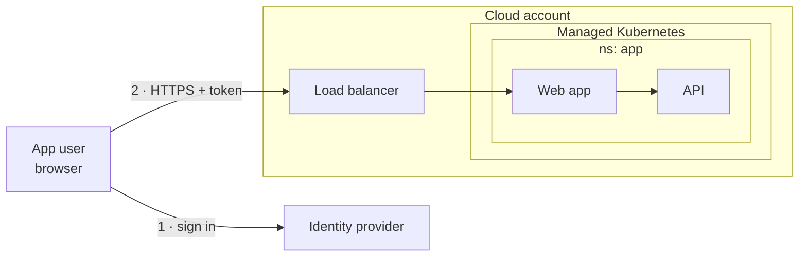

# Other formats

Build the JSON model first, whatever the format. It forces the fact-gathering and keeps every export consistent. Then translate it.

| Asked for | Produce | Notes |
| --- | --- | --- |
| HTML page (default) | `scripts/build.py` | Interactive flows, hover cards, inventory |
| PNG / screenshot | `scripts/render.sh` on the HTML | One PNG per flow plus "all flows" |
| PDF | Print the HTML from Chromium | `chrome --headless=new --print-to-pdf=out.pdf file://…#all` |
| SVG only | Copy the rendered `<svg id="d">` from the page | Inline the `<symbol>` defs it uses; CSS variables must be resolved to colors |
| Mermaid | `flowchart LR` with `subgraph` per container | Good for READMEs and PR descriptions; no icons |
| D2 | Containers as nested maps, `icon:` per node | Better layout than Mermaid; supports icons by URL |
| draw.io / diagrams.net | `.drawio` XML | Editable by non-engineers; use the built-in Kubernetes/AWS/GCP shape libraries |
| Markdown doc | Mermaid diagram + the flows and inventory as lists/tables | For wikis that render Mermaid |

## Mapping the model

| Model | Mermaid | D2 | draw.io |
| --- | --- | --- | --- |
| container | `subgraph id["title"] … end` | `id: title { … }` | swimlane / container shape with children |
| node | `id["title subtitle"]` | `id: "title" { icon: <url> }` | shape with `parent` = container id |
| edge | `a -->|"label"| b` (`-.->` when dashed) | `a -> b: label` (`style.stroke-dash: 4`) | `edge` with `source`/`target` |
| flow | `linkStyle <n> stroke:<color>` per edge index | `style.stroke: <color>` | one layer per flow |
| planned | `classDef planned stroke-dasharray:5 5` | `style.stroke-dash: 5` | dashed stroke |

Edges in the model are point lists, not source/target pairs. For graph formats, take the source as the node whose border holds the first point and the target as the node whose border holds the last point; skip edges that only feed a lane.

## Mermaid skeleton

Keep the same safety rules in every format: no IPs, account IDs, internal hostnames, secrets or personal data.
